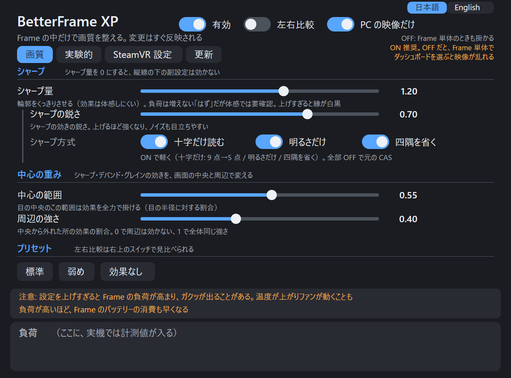
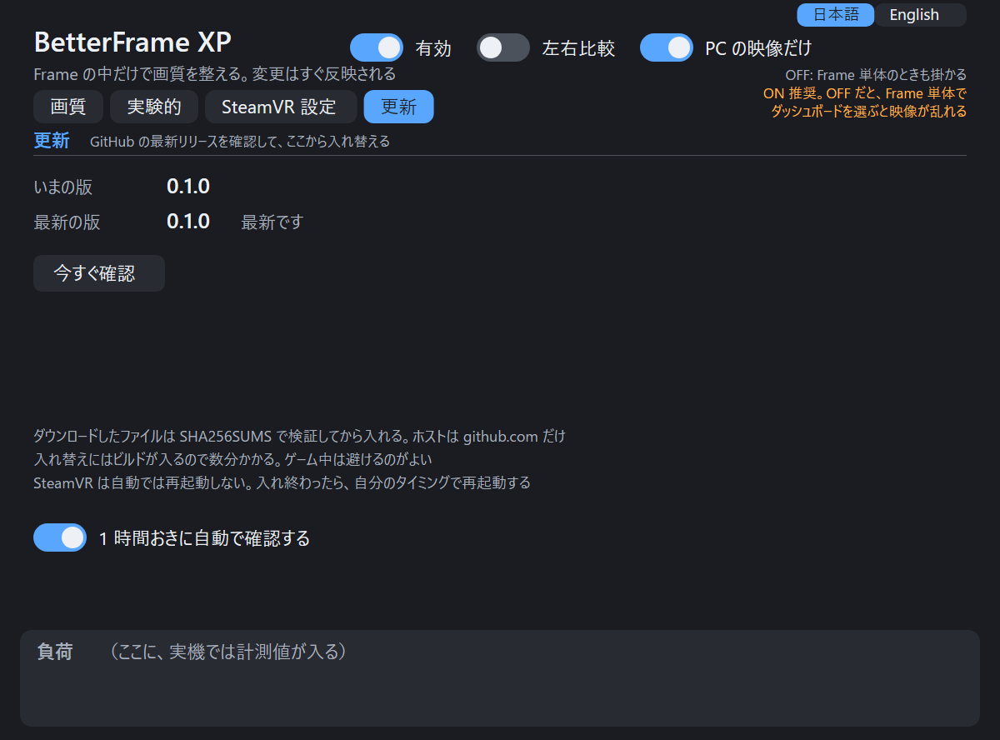
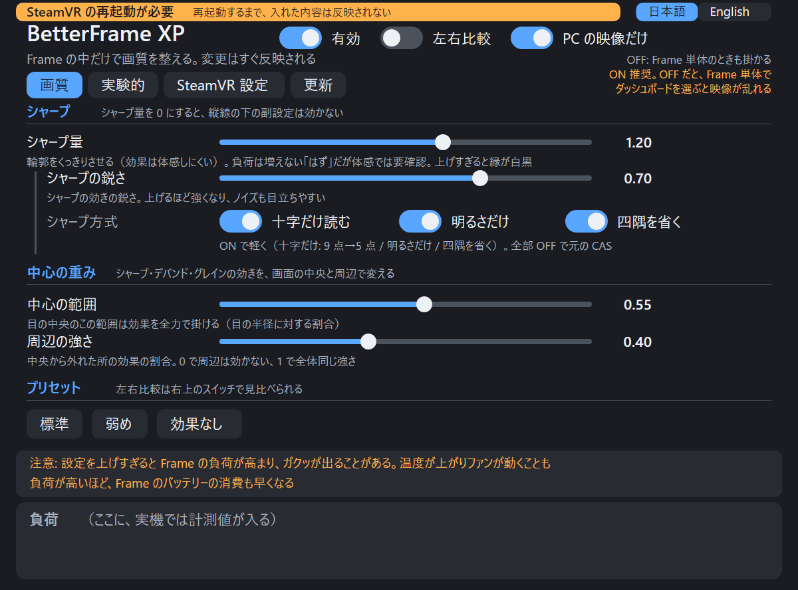

# BetterFrame XP

Steam Frame で、PC から Steam Link で送られてくる映像に**シャープ（AMD CAS）を Frame 側で後掛け**する。VRChat の草や葉が「泥のように」つぶれるのを、少し目立たなくするための道具。

> **状態: 試作。** 作者の Frame 1 台でしか確認していない。効果が確認できているのはシャープだけ。入れても戻せる作りにしてあるが、動作の保証はない。

## なぜ Frame 側なのか

無線では映像が圧縮されて、細かい模様が先に捨てられる。捨てられたものは戻せない。ただ、PC 側でシャープを掛けると、強調した細部がまた圧縮のビットを食う。**デコードしたあと（Frame 側）に掛ければ、ビットは使わない。** 詳しくは [ガイド](docs/GUIDE.md#映像が通る道pc--frame)。

```
PC ─ エンコード ─ 無線 ─▶ Frame: デコード ─▶ コンポジタ ─▶ ★ここでシャープ ─▶ ディスプレイ
```

## インストール（Frame 上で 1 コマンド）

```sh
git clone <このリポジトリ> && cd betterframe-xp
sh contrib/setup.sh
```

確認 → ビルド（1 分ほど）→ 導入 → 有効化まで進む。足りないものがあれば、何も変えずに理由を出して止まる。まず確認だけなら `sh contrib/setup.sh --check`。

そのあと**遊んでいないときに SteamVR を再起動**する（`setup.sh` は再起動しない）。

```sh
~/.local/bin/betterframectl status   # "loaded in vrcompositor" と出れば成功
```

PC 側の SteamVR で、エンコード前のシャープ（`useSharpening`）は**切っておく**。両方掛けると二重になる。

必要なもの: Steam Frame（SteamOS、aarch64）。root 不要。ビルド道具は SteamOS 0.5.6 に最初から入っていた。ダッシュボードのパネルも一緒に入って有効になる（日本語フォント `noto-cjk` などが要る。足りなければ `setup.sh` が止まる。パネル不要なら `--no-panel`）。

## 使い方

パネルの見た目（`panel/tools/panel_preview.py --shots` で作った画像）:

| 画質 | 更新 | 再起動の表示 |
|---|---|---|
|  |  |  |

画像は実機の画面ではなく、パネルの描き方を HTML に写した見本（数値は既定値、負荷の欄は実機で計測値が入る場所）。

- **ダッシュボードの「BetterFrame XP」パネル**で、掛け具合を見ながら変える（画質 / 実験的 / SteamVR 設定 / 更新）。右上に「有効」「左右比較」「PC の映像だけ」のスイッチがある。画質タブは「シャープ」「中心の重み」「プリセット」、実験的タブは「デバンド」「シャープの補助」「グレイン」の段落に分けてあり、縦線の下の副設定は、その段落の量（シャープ量・デバンド量・グレイン量）が 0 のときは効かない。「SteamVR 設定」タブのスイッチだけが、Frame の SteamVR 自体の設定を書き換える。各スイッチを切ったときの効果は、そのタブに Tips で書いてある。
- パネルが要らないときは、ダッシュボード下のアイコンバーで BetterFrame XP のアイコンにカーソルを合わせ、「閉じる」を押す。パネルのプログラムが終わり、**「有効」が OFF になる**（設定の `enabled` が 0 になり、シャープなどは素通しになる。操作する画面が無いまま掛かりっぱなしになるのを防ぐため）。ほかの設定の値は変わらない。次の SteamVR 起動でパネルはまた出るが、「有効」は OFF のままなので、使うときは自分で ON にする。ずっと出したくなければ `betterframectl panel-off`。
- 閉じたあとでまた出したいときは、ダッシュボードの「＋」ボタンの一覧から「BetterFrame XP」を選ぶ（インストールで `~/.local/share/applications/` に `.desktop` とアイコンを置く。すでに動いているときは何もしない）。出したあと、右上の「有効」を ON にする。
- または 1 行で:

```sh
betterframectl set sharpenAmount 1.0   # シャープの量（0 でなし）
betterframectl off                     # すぐ素通し
betterframectl on
```

- **「SteamVR の再起動が必要」**: 入れたり更新したりしたあと、SteamVR を再起動するまで内容は反映されない。パネルの上に橙色の帯で「SteamVR の再起動が必要」と出るので、遊んでいないときに再起動する（このツールは再起動しない）。再起動すると帯は消える。判定は、レイヤーを有効にしてあるかと、動いている vrcompositor が読み込んでいるレイヤーが最新の入れ替え後のものか、の比較。
- **更新**: 「更新」タブで、GitHub の最新リリースを確認し、新しければ「この版に更新する」で入れ替えられる。ダウンロードしたファイルは SHA-256 を確かめてから入れる。入れ替えは別のプロセスで低い優先度で動き、パネルを閉じても続く。SteamVR は再起動しない（反映は次の SteamVR 起動から）。1 時間ごとの自動確認は同じタブで切れる。GitHub の公開リリースだけを見る（非公開リポジトリは確認できない）。手動で更新するなら、これまでどおり `git pull` して `sh contrib/install.sh`。
- 効果は体感しにくい。**強さを上げても負荷は増えない「はず」**（シャープ量は最後の掛け算に使うだけで、読む画素も計算の量も同じ。負荷が変わるのは 0 か、0 より大きいかだけ。強さを変えての測定はしていない）。ただし作者の体感では「強めの設定ほどガクッとなりやすい」で、式のうえの予想と**食い違っている（未解決）**。強さを上げて引っかかりが増えたら下げてほしい。詳しくは [docs/STUTTER.md](docs/STUTTER.md) の A-3。
- 効いているかは、`betterframectl set showSplit 1` で各目の中央に線を引き、左は素通し・右は処理後で見比べる。
- 値の意味と、**どれが効いていると言えるか**は [設定リファレンス](docs/SETTINGS.md)。
- 文書では、変えるとこうなる「**はず**」（計算式やコードから言える予想）と、「**作者が体感したこと**」（作者 1 人・Frame 1 台）を分けて書いてある。他の人が試すときは、前者を目安にしてほしい。

## 戻す

```sh
betterframectl disable     # 次の SteamVR 起動から読ませない
betterframectl uninstall   # 全部消す（SteamVR を起動した状態で）
```

SteamVR の起動に失敗が続いたら、自動でレイヤーを外す仕組みもある（[ガイド](docs/GUIDE.md#起動に失敗したとき自動ガード)）。

## 知っておくこと

> **注意: 設定を上げすぎると、Frame の GPU 負荷が高まり、ガクッが出る可能性があります。** 負荷が上がると Frame の温度も上がり、ファンが動くことがあります。**バッテリーの消費も早くなります。** パネルの下の「負荷」の数字（GPU ms）を見ながら、上げすぎないようにしてください。ガクッの種類は [docs/STUTTER.md](docs/STUTTER.md)。

- **今のビルドはヘッドセット内で未確認**（SteamVR の再起動後に確認する段階）。
- **画面を 72 Hz / 80 Hz にすると、シャープを掛けているときに一定の間隔で引っかかることがある**（作者の Frame 1 台で確認。原因は未確定）。**144 Hz で使うか、72 / 80 Hz のときは `sharpenAmount` を 0 にしてほしい。** 作者の記録では、シャープを切ると止まった。詳しくは [docs/STUTTER.md](docs/STUTTER.md) の F。
- パネルの「視線の補正」だけは、このレイヤーではなく **SteamVR の設定**（Frame のアイトラッキング補正 2 つ）を書き換える。押したときだけ書く。最初の値を控えてあり、`uninstall` が戻す。作者の環境ではオフのほうが揺れが減ったが、1 人・1 台の体感。
- 失われた細部は作れない（超解像ではない）。`sharpenAmount` を 1 より上げると縁に白黒の縁取りが出やすい。
- OS / SteamVR の更新で動かなくなる可能性がある。
- 「実験的」タブ（デバンド・グレインなど）は、見た目の評価がまだ十分ではない。
- **デバンド量を調整すると、映像が乱れる不具合がある**（パネルの実験的タブにも書いてある）。乱れたら `debandAmount` を 0 に戻す。条件や原因はまだ調べていない。

## 読み物

| 文書 | 内容 |
|---|---|
| [docs/GUIDE.md](docs/GUIDE.md) | 詳しいガイド。映像の通り道、置き場所の一覧、各補正の技術説明、元に戻し方、既知の問題 |
| [docs/SETTINGS.md](docs/SETTINGS.md) | 設定の一覧と、確認できていること / できていないこと |
| [docs/STUTTER.md](docs/STUTTER.md) | 「ガクッ」の種類（6 種）と、このツールが関係するもの / しないもの。引っかかりが出たときの見分け方 |
| [docs/ARCHITECTURE.md](docs/ARCHITECTURE.md) | 実装の説明（レイヤー、映像の検出、計測） |
| [THIRD_PARTY.md](THIRD_PARTY.md) | 元にしたコードとライセンス |

## ライセンス

MIT License（[LICENSE](LICENSE)）。Copyright (c) 2026 omuomu0909。

元にしたコードは別のライセンスで、それぞれの表示は [THIRD_PARTY.md](THIRD_PARTY.md) と各ディレクトリの `LICENSE` にある（layer は zlib、パネルの一部は MIT、OpenVR ヘッダは BSD-3-Clause、CAS と deband は MIT）。
